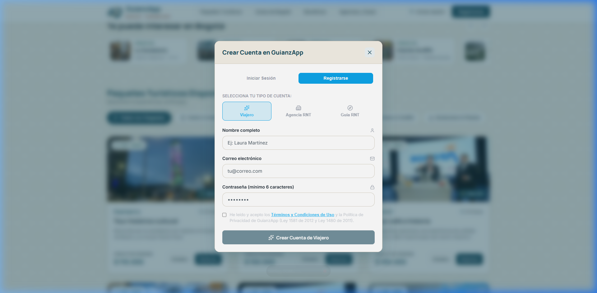
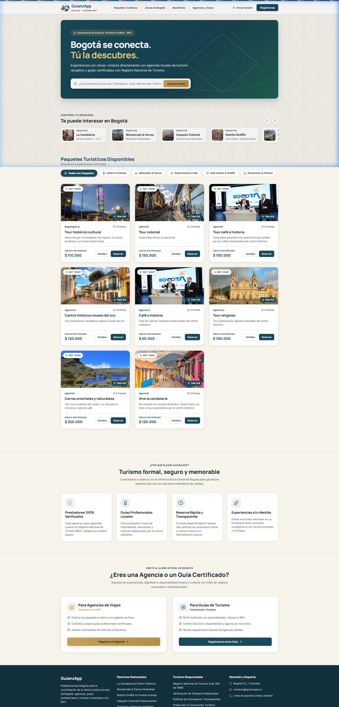
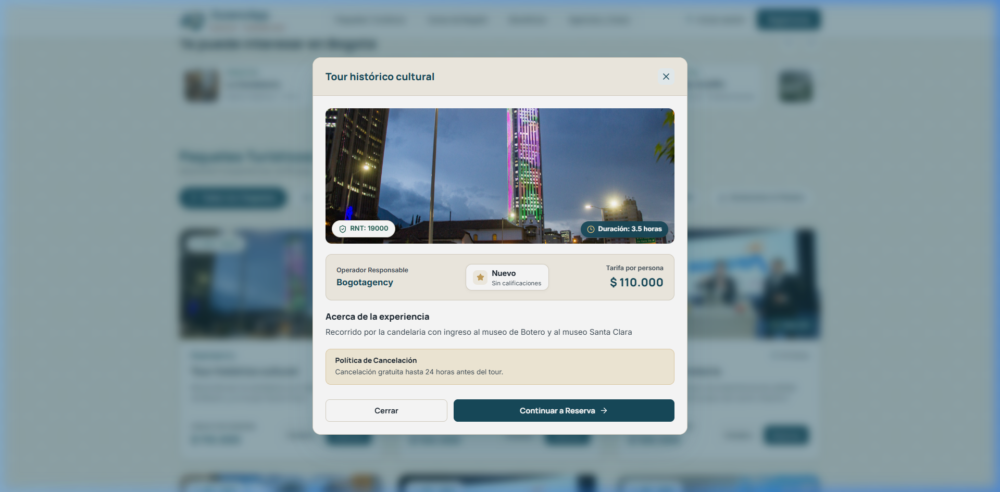
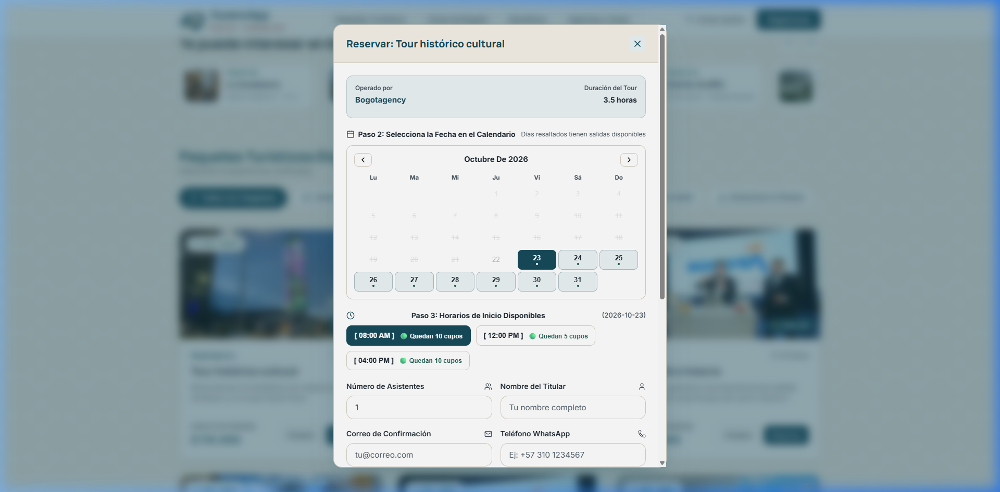
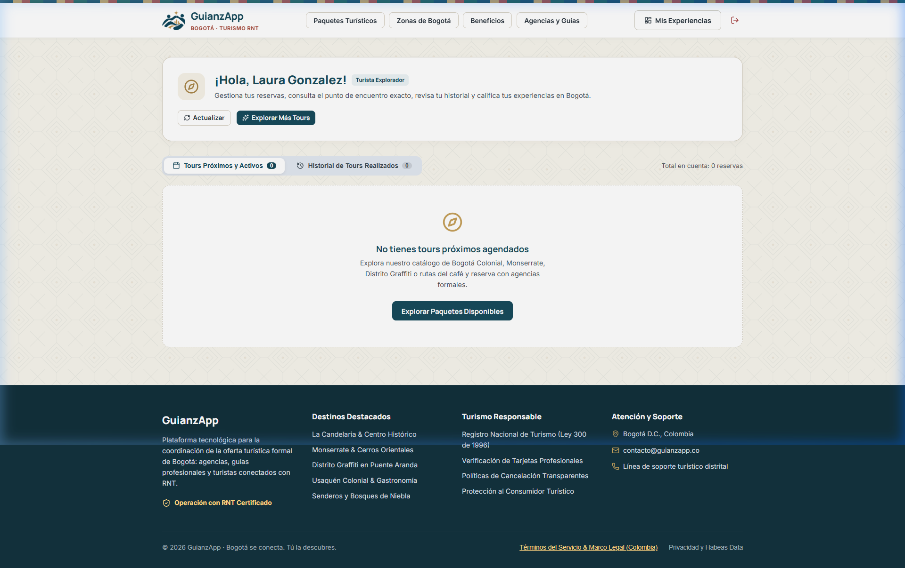
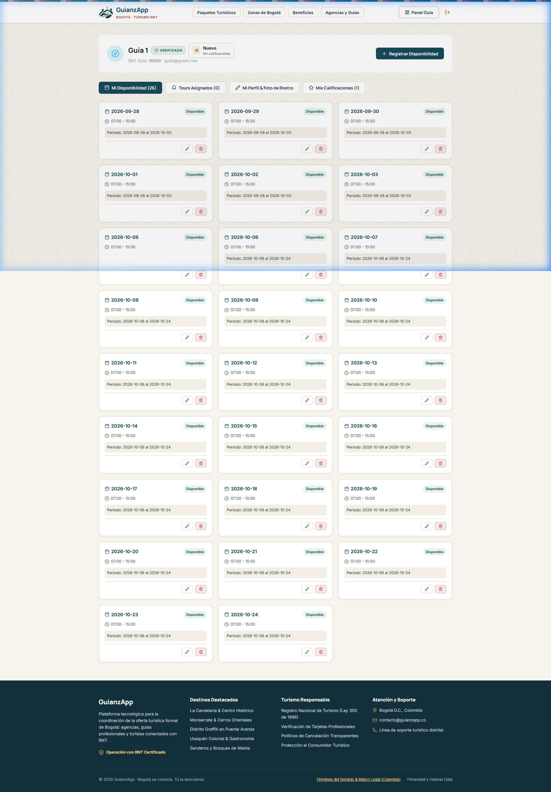
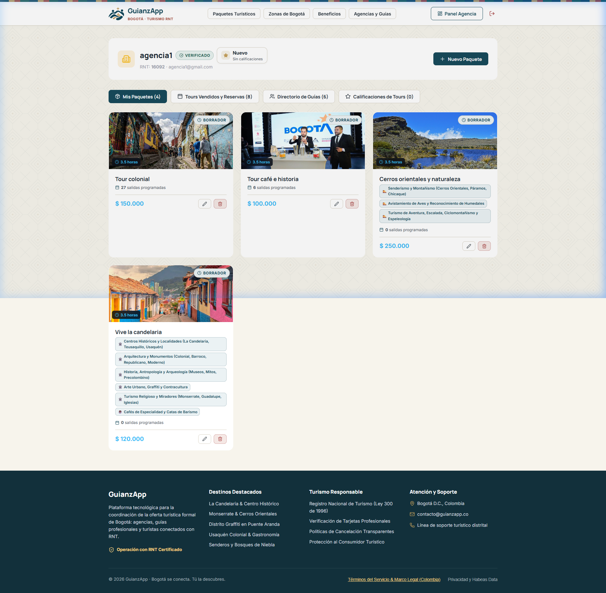
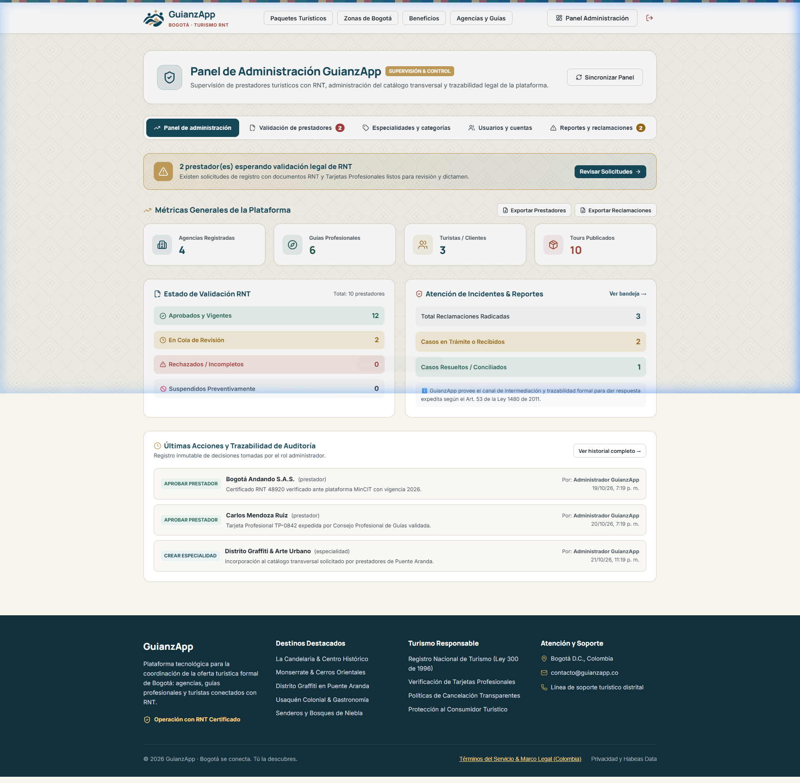

# MANUAL DE USUARIO Y GUÍA DE TRANSACCIONES
## GuianzApp — Plataforma Web Progresiva (PWA) de Turismo Certificado y Coordinación RNT en Bogotá D.C.

---

**Código Documental:** MNU-GNZ-2026-V1  
**Versión:** 1.0.0  
**Fecha de Publicación:** Octubre 2026  
**Entorno Operativo:** Web / PWA (Escritorio, Android, iOS)  
**Marco Legal y Normativo:** Ley 300 de 1996 (Ley General de Turismo), Ley 1558 de 2012, Ley 2068 de 2020, Ley 1480 de 2011 (Estatuto del Consumidor) y Normas Técnicas Sectoriales de Guianza (NTS-GT001).

---

## TABLA DE CONTENIDO

1. [INTRODUCCIÓN Y PROPÓSITO DEL SISTEMA](#1-introducción-y-propósito-del-sistema)
2. [ROLES Y PERFILES DEL SISTEMA](#2-roles-y-perfiles-del-sistema)
3. [ACCESO AL SISTEMA Y REQUISITOS TÉCNICOS](#3-acceso-al-sistema-y-requisitos-técnicos)
4. [MÓDULO DE AUTENTICACIÓN Y REGISTRO](#4-módulo-de-autenticación-y-registro)
   - 4.1 Inicio de Sesión Unificado
   - 4.2 Proceso de Recuperación de Contraseña
   - 4.3 Registro de Turista
   - 4.4 Registro de Guía Turístico Profesional (Validación Documental)
   - 4.5 Registro de Agencia de Viajes y Operadora (Acreditación RNT)
5. [MÓDULO DEL TURISTA (EXPLORACIÓN, RESERVA Y EVALUACIÓN)](#5-módulo-del-turista-exploración-reserva-y-evaluación)
   - 5.1 Explorador de Experiencias y Filtros Especializados
   - 5.2 Ficha Técnica y Detalle del Tour
   - 5.3 Transacción de Reserva y Agendamiento en Tiempo Real
   - 5.4 Panel "Mis Experiencias", Vouchers y Calificaciones
6. [MÓDULO DEL GUÍA TURÍSTICO (DISPONIBILIDAD Y SERVICIOS)](#6-módulo-del-guía-turístico-disponibilidad-y-servicios)
   - 6.1 Gestión del Perfil Profesional, Idiomas y Especialidades NTS
   - 6.2 Configuración del Calendario de Disponibilidad
   - 6.3 Recepción y Aceptación de Asignaciones de Agencias
   - 6.4 Historial de Servicios y Métricas de Reputación
7. [MÓDULO DE LA AGENCIA DE VIAJES (GESTIÓN DE PAQUETES Y OPERACIÓN)](#7-módulo-de-la-agencia-de-viajes-gestión-de-paquetes-y-operación)
   - 7.1 Catálogo de Paquetes: Creación, Itinerario y Multimedia
   - 7.2 Configurador de Programación y Salidas con Guías Certificados
   - 7.3 Directorio de Guías Verificados
   - 7.4 Monitoreo de Reservas y Manifiesto de Pasajeros
8. [MÓDULO DEL ADMINISTRADOR (SUPERVISIÓN, AUDITORÍA Y CONTROL LEGAL)](#8-módulo-del-administrador-supervisión-auditoría-y-control-legal)
   - 8.1 Tablero de Control y Métricas Distritales
   - 8.2 Mesa de Dictamen y Validación Documental de RNT y Tarjetas
   - 8.3 Administración del Catálogo de Especialidades
   - 8.4 Trazabilidad de Auditoría y Atención de Reclamaciones
9. [PREGUNTAS FRECUENTES (FAQ) Y RESOLUCIÓN DE INCIDENCIAS](#9-preguntas-frecuentes-faq-y-resolución-de-incidencias)

---

## 1. INTRODUCCIÓN Y PROPÓSITO DEL SISTEMA

**GuianzApp** es una solución tecnológica desarrollada bajo el paradigma de Aplicación Web Progresiva (PWA), concebida para formalizar, articular y dinamizar el ecosistema de turismo receptivo en Bogotá D.C. 

La plataforma resuelve la desarticulación operativa existente entre agencias de viajes, guías profesionales de turismo y visitantes (nacionales e internacionales), garantizando que todas las experiencias ofrecidas cuenten con respaldo legal verificable:
- **Registro Nacional de Turismo (RNT)** expedido por las Cámaras de Comercio y vigilado por el Viceministerio de Turismo.
- **Tarjeta Profesional de Guía de Turismo** conforme a las disposiciones del Consejo Profesional de Guías de Turismo.
- **Transparencia en tarifas, cupos e itinerarios** con sujeción al régimen de protección al consumidor turístico.

---

## 2. ROLES Y PERFILES DEL SISTEMA

| Rol | Descripción Funcional | Permisos Clave |
| :--- | :--- | :--- |
| **Turista / Visitante** | Usuario final que busca, compara y reserva experiencias culturales, ecológicas o urbanas. | Búsqueda filtrada, visualización de fichas técnicas, reserva de cupos, simulación transaccional, descarga de vouchers y calificación del servicio. |
| **Guía de Turismo** | Profesional acreditado que presta el servicio de guianza e interpretación del patrimonio. | Gestión de hoja de vida, declaración de idiomas y especialidades, fijación de calendario de disponibilidad, aceptación de tours y consulta de reseñas. |
| **Agencia de Viajes** | Operador turístico formalizado que diseña, empaqueta y comercializa las rutas en Bogotá. | Creación y edición de paquetes (CRUD), programación de salidas calendarizadas, asignación de guías habilitados, control de reservas y lista de pasajeros. |
| **Administrador del Sistema** | Entidad fiscalizadora y moderadora de la plataforma GuianzApp. | Auditoría documental de RNT y tarjetas, aprobación/rechazo de prestadores, administración de taxonomías turísticas, métricas y conciliación de reclamos. |

---

## 3. ACCESO AL SISTEMA Y REQUISITOS TÉCNICOS

### 3.1 Requisitos de Hardware y Software
- **Navegadores recomendados:** Google Chrome (v110+), Mozilla Firefox (v115+), Safari (v16+) o Microsoft Edge (v110+).
- **Conectividad:** Conexión a Internet de banda ancha o móvil (3G/4G/5G).
- **Capacidades Offline (PWA):** La plataforma utiliza Service Workers y caché Workbox para permitir la visualización de vouchers previamente descargados e itinerarios guardados en condiciones de baja o nula cobertura celular (útil en senderos de Cerros Orientales o páramos).

### 3.2 Instalación como Progressive Web App (PWA)
1. Ingrese a la URL oficial de la aplicación desde su dispositivo móvil o de escritorio.
2. Observe el banner emergente inferior o el ícono de instalación en la barra de direcciones del navegador: **"Instalar GuianzApp"**.
3. Haga clic en **Instalar**. La aplicación creará un acceso directo nativo en su pantalla de inicio, operando en ventana independiente sin barras de navegación del explorador.

---

## 4. MÓDULO DE AUTENTICACIÓN Y REGISTRO

El sistema dispone de un punto centralizado de acceso mediante ventanas modales que garantizan la navegación continua sin recargar la página.

### 4.1 Inicio de Sesión Unificado

#### Pasos para Iniciar Sesión:
1. En la barra de navegación superior derecha, haga clic en el botón **Iniciar sesión**.
2. Ingrese su **Correo electrónico** registrado.
3. Ingrese su **Contraseña** (mínimo 8 caracteres).
4. Presione el botón **Iniciar Sesión**.
5. El sistema validará su token JWT ante Supabase Auth. Si las credenciales son correctas:
   - Se desplegará una notificación toast de bienvenida.
   - La barra de navegación se actualizará mostrando su nombre y el botón de acceso directo a su panel:
     - **"Mis Experiencias"** (Turistas).
     - **"Panel de Guía"** (Guías de Turismo).
     - **"Panel de Agencia"** (Agencias de Viajes).
     - **"Panel Administración"** (Administradores).

---

### 4.2 Proceso de Recuperación de Contraseña

En caso de extravío de credenciales:
1. En el modal de inicio de sesión, haga clic en el hipervínculo **"¿Olvidaste tu contraseña?"**.
2. Escriba el correo electrónico asociado a la cuenta.
3. Presione **"Enviar enlace de restablecimiento"**.
4. Recibirá un mensaje de correo con un token único de un solo uso válido por 60 minutos.
5. Al hacer clic en el enlace del correo, el sistema abrirá automáticamente el formulario para digitar y confirmar su nueva clave segura.

---

### 4.3 Selección de Perfil para Registro

Al hacer clic en la pestaña **"Crear Cuenta"**, el sistema presentará el selector de perfiles:

Existen tres modalidades de afiliación:
1. **Turista:** Proceso inmediato y simplificado.
2. **Guía Certificado:** Requiere acreditación con Tarjeta Profesional y RNT personal.
3. **Agencia de Viajes:** Requiere acreditación de RNT institucional y razón social.

---

### 4.4 Registro de Turista
1. Seleccione la opción **"Soy Turista"**.
2. Diligencie los campos requeridos:
   - **Nombre completo**.
   - **Correo electrónico**.
   - **Número telefónico de contacto** (para notificaciones SMS/WhatsApp de punto de encuentro).
   - **Contraseña**.
3. Acepte los Términos de Servicio y la Política de Tratamiento de Datos Personales (Habeas Data - Ley 1581 de 2012).
4. Haga clic en **"Crear Cuenta de Turista"**. La cuenta se activa de forma instantánea.

---

### 4.5 Registro de Guía Turístico Profesional
1. Seleccione **"Soy Guía de Turismo"**.
2. Complete la información legal y operativa:
   - **Nombre y apellidos completos** según cédula de ciudadanía.
   - **Número de Tarjeta Profesional de Guía de Turismo**.
   - **Número de Registro Nacional de Turismo (RNT)** como persona natural.
   - **Idiomas dominados** (Español, Inglés, Francés, Alemán, Portugués, etc.).
   - **Especialidades operativas** (Historia colonial, Avistamiento de aves, Biciturismo, Senderismo, Arte urbano).
   - **Adjunto documental 1:** Copia escaneada de la Tarjeta Profesional (PDF o JPG/PNG legible).
   - **Adjunto documental 2:** Certificado vigente de RNT.
3. Envíe el formulario. El sistema asignará el estado **"Pendiente de Validación Legal"**. Un administrador revisará la autenticidad de los soportes antes de habilitar la cuenta en el directorio público.

---

### 4.6 Registro de Agencia de Viajes y Operadora
1. Seleccione **"Soy Agencia de Viajes"**.
2. Suministre la información corporativa:
   - **Razón Social** o Nombre Comercial de la Agencia.
   - **Número de Identificación Tributaria (NIT)**.
   - **Número de RNT de Agencia Operadora**.
   - **Correo electrónico corporativo** y teléfono de operaciones.
   - **Adjunto documental:** Certificado de RNT expedido por la Cámara de Comercio con vigencia activa.
3. Al enviar la solicitud, el perfil entrará en estado **"Pendiente de Aprobación"**, notificando a la administración central para el cotejo con el registro oficial.

---

## 5. MÓDULO DEL TURISTA (EXPLORACIÓN, RESERVA Y EVALUACIÓN)

El turista cuenta con una experiencia intuitiva para descubrir el patrimonio vivo, gastronómico y natural de Bogotá.

### 5.1 Explorador de Experiencias y Filtros

#### Mecanismos de Búsqueda:
1. **Buscador Semántico Central:** Permite ingresar palabras clave como *"Chorro de Quevedo"*, *"Monserrate"*, *"Café"*, *"Graffiti"*, *"Páramo"*.
2. **Carrusel de Zonas Emblemáticas:**
   - **La Candelaria:** Centro histórico, museos y arquitectura colonial.
   - **Monserrate y Cerros Orientales:** Turismo de naturaleza, miradores y senderismo.
   - **Usaquén Colonial:** Mercados campesinos, gastronomía y cata de café de origen.
   - **Distrito Graffiti (Puente Aranda):** Muralismo contemporáneo y contracultura urbana.
   - **Bosques de Niebla & Ecoturismo:** Alta montaña andina y educación ambiental.
3. **Filtros por Categoría:** Segmentación rápida por pestañas interactivas.

---

### 5.2 Ficha Técnica y Detalle del Tour

Al presionar el botón **"Detalles"** sobre cualquier tarjeta del catálogo, se despliega la ficha completa:

#### Información técnica disponible:
- **Título oficial y galería de fotografías**.
- **Duración estimada** del recorrido (ej: 3.5 horas).
- **Agencia Operadora Responsable** y su **Número de RNT visible**, garantizando contratación formal.
- **Punto de Encuentro Exacto:** Dirección y coordenadas de partida segura.
- **Descripción e Itinerario Detallado:** Pasos del recorrido, paradas interpretativas y componentes incluidos (degustaciones, ingresos a recintos, seguros de asistencia médica).
- **Política de Cancelación:** Reglas claras para desistimiento (ej: cancelación 100% gratuita hasta 24 horas antes).

---

### 5.3 Transacción de Reserva y Agendamiento en Tiempo Real

Al hacer clic en el botón **"Reservar"**, se inicializa la pasarela transaccional:

#### Flujo Transaccional Paso a Paso:
1. **Selección de Fecha:** El sistema presenta las fechas habilitadas con salidas programadas por la agencia operadora.
2. **Selección del Horario / Franja:** Turnos de mañana o tarde con disponibilidad garantizada.
3. **Selección de Cupos:** Mediante los selectores numéricos `+` y `-`, indique el número de viajeros. El sistema validará en milisegundos que el cupo solicitado no supere el aforo máximo permitido en la salida.
4. **Cálculo Automático de Tarifa:**
   $$\text{Total Transacción} = \text{Precio Unitario} \times \text{Número de Pasajeros}$$
5. **Aceptación de Términos y Condiciones:** Checkbox de cumplimiento legal conforme a la Ley 1480 de 2011 y las políticas de bioseguridad y ecoturismo de Bogotá.
6. **Confirmación y Pago:** Presione **"Confirmar y Pagar"**.
   - El sistema procesa la reserva, descuenta los cupos de la base de datos de manera atómica para evitar sobreventas (overbooking) y genera un **Código Único de Reserva (UUID)**.
   - Se despacha automáticamente un comprobante digital vía correo electrónico con el resumen del agendamiento.

---

### 5.4 Panel "Mis Experiencias", Vouchers y Calificaciones

Al iniciar sesión como turista y pulsar sobre **"Mis Experiencias"** en la barra superior:

#### Funcionalidades del Panel:
- **Pestaña "Tours Próximos y Activos":**
  - Muestra las reservas vigentes con fecha, hora de encuentro, guía asignado y teléfono de soporte.
  - Botón **"Descargar Comprobante / Voucher"**: Genera el tiquete digital con código QR para presentar al guía al momento de abordar el recorrido.
  - Opción de **"Solicitar Cancelación"**: Si se realiza dentro del margen de la política de la agencia, el sistema libera los cupos y gestiona la devolución.
- **Pestaña "Historial de Tours Realizados":**
  - Bitácora de recorridos culminados con éxito.
  - Botón **"Calificar Experiencia"**: Permite otorgar una puntuación de 1 a 5 estrellas y redactar un comentario público que enriquecerá el índice de reputación del guía y de la agencia.

---

## 6. MÓDULO DEL GUÍA TURÍSTICO (DISPONIBILIDAD Y SERVICIOS)

El guía profesional dispone de un conjunto de herramientas para autogestionar su tiempo y vincularse laboralmente con las agencias registradas.

### 6.1 Panel Principal y Calendario de Disponibilidad

#### Cabecera del Panel del Guía:
- Nombre profesional, distintivo **"VERIFICADO"**, número de RNT y promedio de estrellas.
- Botón principal: **"+ Registrar Disponibilidad"**.

#### Pestañas de Gestión:
1. **Mi Disponibilidad:**
   - Cuadrícula cronológica con las fechas donde el guía ha manifestado estar libre para trabajar.
   - Muestra franjas horarias configuradas (ej: 07:00 a 15:00).
   - Acciones directas: Editar horario o eliminar disponibilidad de una fecha específica.
2. **Tours Asignados:**
   - Lista de recorridos donde una agencia lo ha seleccionado como guía oficial.
   - Permite **Aceptar** o **Declinar** la asignación. Al aceptar, la fecha queda bloqueada en su calendario para evitar cruces de agenda.
   - Muestra la lista de pasajeros confirmados y el número de contacto del coordinador de la agencia.
3. **Mi Perfil & Foto de Rostro:**
   - Actualización de biografía, idiomas, enlaces de contacto y carga de fotografía profesional con uniforme o escarapela RNT.
4. **Mis Calificaciones:**
   - Registro de opiniones y valoraciones dejadas por los turistas al finalizar los tours.

---

## 7. MÓDULO DE LA AGENCIA DE VIAJES (GESTIÓN DE PAQUETES Y OPERACIÓN)

Las agencias disponen de un centro de mando para estructurar su catálogo, programar salidas recurrentes y auditar la trazabilidad de sus ventas.

### 7.1 Panel de Operaciones de la Agencia

#### Indicadores y Controles Superiores:
- Nombre de la agencia, insignia **"VERIFICADO"**, RNT visible (ej: 16092).
- Botón **"+ Nuevo Paquete"**: Despliega el formulario para crear experiencias turísticas.

#### Módulos de Operación:

#### 1. Mis Paquetes:
- Listado de tours propios clasificados por estado (**Borrador**, **En Revisión**, **Publicado**).
- Cada tarjeta presenta:
  - Fotografía de portada optimizada.
  - Título y duración (ej: 3.5 horas).
  - Número de salidas programadas a futuro (ej: 27 salidas activas).
  - Etiquetas NTS asignadas (Senderismo, Historia colonial, Avistamiento de fauna, etc.).
  - Precio por persona en pesos colombianos ($ COP).
  - Acciones: **Editar ficha técnica** o **Eliminar paquete**.

#### 2. Configurador de Programación y Salidas:
- Permite abrir fechas en el calendario para un paquete específico.
- Configuración de hora de inicio, hora de finalización, punto de partida y aforo máximo (cupos totales).
- **Asignación de Guía:** El sistema filtra el directorio distrital mostrando únicamente guías certificados que tengan marcada disponibilidad libre para esa fecha y horario exacto.

#### 3. Tours Vendidos y Reservas:
- Matriz de control de pasajeros en tiempo real.
- Permite consultar el nombre del turista titular, número de personas, estado del pago y fecha de compra.
- Opción de exportar el **Manifiesto de Pasajeros** en formato para control de las autoridades de turismo o empresas de transporte especial.

#### 4. Directorio de Guías:
- Base de datos de guías profesionales verificados por GuianzApp, con acceso a su hoja de vida, idiomas dominados y tarifas referenciales.

---

## 8. MÓDULO DEL ADMINISTRADOR (SUPERVISIÓN, AUDITORÍA Y CONTROL LEGAL)

El administrador ejerce la autoridad de supervisión para garantizar que la plataforma opere bajo estrictos estándares de legalidad y calidad turística.

### 8.1 Tablero de Control y Supervisión Distrital

#### 1. Métricas Generales de la Plataforma:
- **Agencias Registradas:** Conteo total de empresas operadoras vinculadas.
- **Guías Profesionales:** Total de guías avalados con tarjeta profesional.
- **Turistas / Clientes:** Base de usuarios exploradores activos.
- **Tours Publicados:** Catálogo total de experiencias verificadas en Bogotá.

#### 2. Alertas de Acción Inmediata:
- Cuadro destacado: **"X prestador(es) esperando validación legal de RNT"**.
- Botón de acción rápida: **"Revisar Solicitudes"**.

#### 3. Estado de Validación RNT:
- Conteo clasificado por semáforo legal:
  - **Aprobados y Vigentes** (Color Verde).
  - **En Cola de Revisión** (Color Amarillo/Ámbar).
  - **Rechazados / Incompletos** (Color Rojo).
  - **Suspendidos Preventivamente** (Color Gris).

#### 4. Atención de Incidentes & Reportes:
- Módulo de reclamaciones conforme al Art. 53 de la Ley 1480 de 2011.
- Conteo de casos radicados, casos en trámite y casos conciliados satisfactoriamente.

#### 5. Bitácora de Auditoría y Trazabilidad:
- Registro inmutable de eventos administrativos:
  - Quién aprobó a un prestador, en qué fecha y bajo qué soporte documental.
  - Historial de cambios en paquetes turísticos y creación de especialidades.
  - Garantía de transparencia frente a auditorías distritales del IDT (Instituto Distrital de Turismo) y MinCIT.

---

## 9. PREGUNTAS FRECUENTES (FAQ) Y RESOLUCIÓN DE INCIDENCIAS

### ¿Qué ocurre si un guía declina una asignación?
La agencia operadora recibe una alerta instantánea en su panel de salidas. La salida pasará a estado *"Requiere Guía"* y la agencia podrá reasignar a otro profesional disponible desde el directorio sin afectar las reservas confirmadas de los turistas.

### ¿Cómo se garantiza la validez de los documentos RNT?
El administrador coteja el número suministrado y el PDF adjunto con el portal oficial del Registro Único Empresarial y Social (RUES) y las bases del Ministerio de Comercio, Industria y Turismo antes de emitir la aprobación.

### ¿Puedo utilizar la app sin conexión a internet?
Sí. Gracias a la tecnología PWA, una vez que haya abierto la aplicación o consultado una reserva, el voucher y la información del punto de encuentro permanecerán guardados en la memoria local de su dispositivo móvil, permitiendo su lectura en zonas sin señal telefónica.

---

*Manual elaborado y auditado conforme a los lineamientos del proyecto de grado GuianzApp. Bogotá D.C., Colombia, 2026.*
