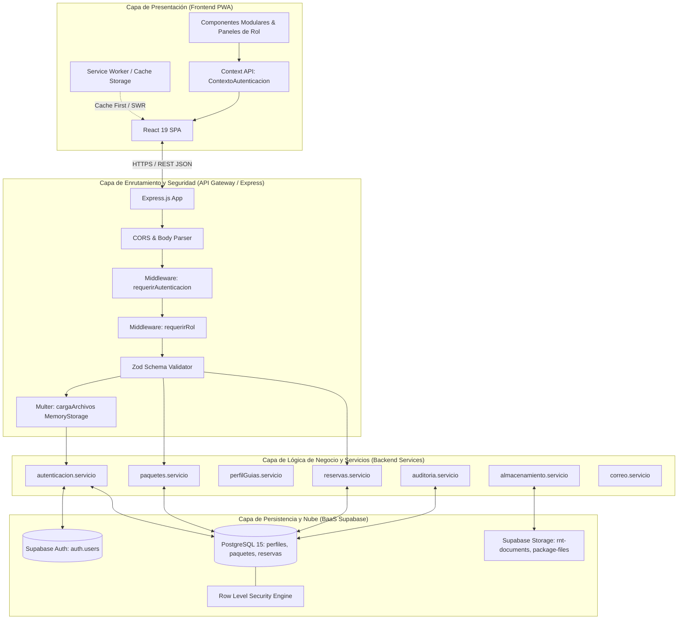
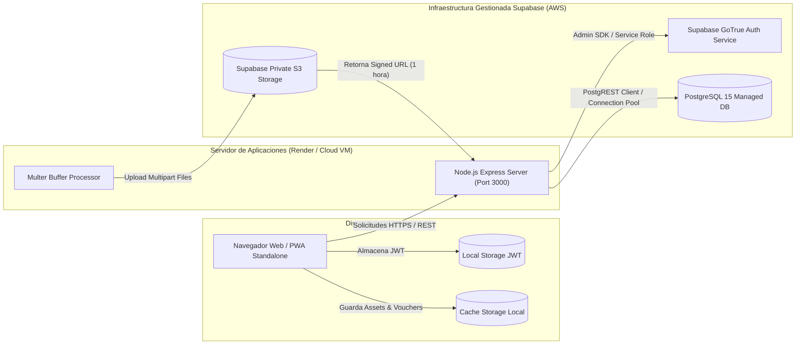
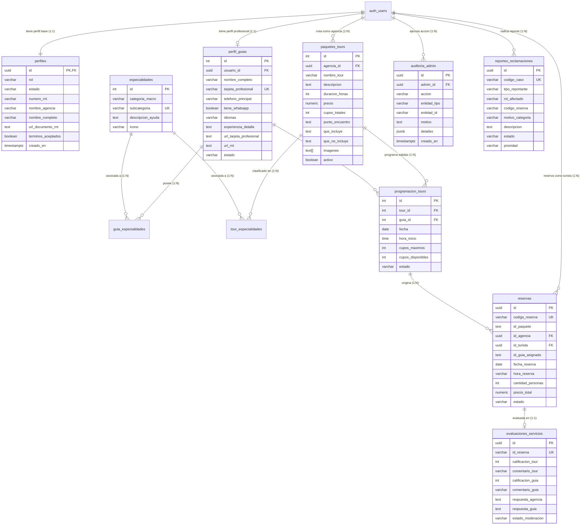

# MANUAL TÉCNICO Y DE ARQUITECTURA DE SOFTWARE
## GuianzApp — Plataforma Web Progresiva (PWA) para la Coordinación Turística y Verificación RNT en Bogotá D.C.

---

**Código Documental:** MNT-GNZ-2026-V1  
**Versión del Sistema:** 1.0.0 (MVP Oficial)  
**Fecha:** Octubre 2026  
**Clasificación:** Documentación Técnica de Arquitectura, Base de Datos y APIs  
**Entorno de Ejecución:** Node.js v20+ LTS, React 19, Supabase PostgreSQL 15, Vite 8 (PWA)  
**Destinatarios:** Equipo de Desarrollo, Evaluadores de Trabajo de Grado, Administradores de Infraestructura y Auditores de Sistemas.

---

## TABLA DE CONTENIDO

1. [INTRODUCCIÓN Y OBJETIVOS DE INGENIERÍA](#1-introducción-y-objetivos-de-ingeniería)
2. [ARQUITECTURA GENERAL DEL SISTEMA](#2-arquitectura-general-del-sistema)
   - 2.1 Patrón Arquitectónico en Capas (Layered Architecture)
   - 2.2 Diagrama de Arquitectura de Componentes
   - 2.3 Diagrama de Despliegue e Infraestructura Cloud
3. [STACK TECNOLÓGICO Y MATRIZ DE DEPENDENCIAS](#3-stack-tecnológico-y-matriz-de-dependencias)
   - 3.1 Tecnologías Frontend
   - 3.2 Tecnologías Backend
   - 3.3 Base de Datos y Almacenamiento de Objetos
4. [MODELO DE DATOS Y BASE DE DATOS RELACIONAL (POSTGRESQL)](#4-modelo-de-datos-y-base-de-datos-relacional-postgresql)
   - 4.1 Diagrama Entidad-Relación (DER)
   - 4.2 Diccionario Técnico de Datos y Tablas
   - 4.3 Políticas de Seguridad a Nivel de Fila (RLS - Row Level Security)
   - 4.4 Procedimientos Almacenados y Triggers
5. [ESPECIFICACIÓN DE LA API REST (CONTRATOS Y ENDPOINTS)](#5-especificación-de-la-api-rest-contratos-y-endpoints)
   - 5.1 Estándar de Comunicación y Códigos HTTP
   - 5.2 Módulo 1: Autenticación y Gestión de Sesiones JWT
   - 5.3 Módulo 2: Catálogo de Paquetes Turísticos
   - 5.4 Módulo 3: Catálogo Transversal de Especialidades NTS
   - 5.5 Módulo 4: Perfil de Guías y Agendas
   - 5.6 Módulo 5: Programación de Salidas y Pasarela de Reservas
   - 5.7 Módulo 6: Sistema de Calificaciones Independientes
   - 5.8 Módulo 7: Panel de Administración Central y Auditoría
6. [ARQUITECTURA DE PROGRESSIVE WEB APP (PWA) Y OPERACIÓN OFFLINE](#6-arquitectura-de-progressive-web-app-pwa-y-operación-offline)
   - 6.1 Configuración del Web App Manifest
   - 6.2 Estrategias de Caché con Workbox y Service Worker
7. [SEGURIDAD, PROTECCIÓN DOCUMENTAL Y AUDITORÍA](#7-seguridad-protección-documental-y-auditoría)
   - 7.1 Cadena de Custodia de Documentos Sensibles (URLs Firmadas)
   - 7.2 Bitácora Inmutable de Auditoría
8. [GUÍA DE INSTALACIÓN, CONFIGURACIÓN Y DESPLIEGUE](#8-guía-de-instalación-configuración-y-despliegue)
   - 8.1 Variables de Entorno (.env)
   - 8.2 Ejecución de Migraciones de Base de Datos
   - 8.3 Puesta en Marcha Local y Compilación de Producción
9. [MATRIZ DE RESOLUCIÓN DE INCIDENCIAS TÉCNICAS (TROUBLESHOOTING)](#9-matriz-de-resolución-de-incidencias-técnicas-troubleshooting)

---

## 1. INTRODUCCIÓN Y OBJETIVOS DE INGENIERÍA

El presente **Manual Técnico** documenta de forma exhaustiva los componentes estructurales, flujos de datos, modelos relacionales, contratos de interfaz de programación (API) y mecanismos de seguridad implementados en **GuianzApp**.

### Objetivos Clave de Ingeniería:
1. **Verificación Documental Segura:** Almacenamiento cifrado y entrega temporalizada de documentos sensibles de prestadores (RNT y Tarjetas Profesionales) mediante buckets de almacenamiento privado y URLs firmadas con caducidad forzada (1 hora).
2. **Atomicidad Transaccional en Reservas:** Algoritmos de control de concurrencia y aforo en base de datos para impedir la sobreventa de cupos turísticos (*overbooking*) en salidas concurrentes.
3. **Resiliencia Operativa Offline (PWA):** Disponibilidad ininterrumpida de comprobantes de reserva, puntos de encuentro y teléfonos de emergencia en zonas de baja o nula cobertura celular (ej: Cerros Orientales, Páramos de Chingaza y Sumapaz).
4. **Trazabilidad y No Repudio:** Registro estricto de todas las decisiones administrativas y transacciones financieras en bitácoras auditables.

---

## 2. ARQUITECTURA GENERAL DEL SISTEMA

### 2.1 Patrón Arquitectónico en Capas (Layered Architecture)

GuianzApp implementa una arquitectura desacoplada estructurada en cuatro niveles principales:



### 2.2 Diagrama de Despliegue e Infraestructura Cloud



---

## 3. STACK TECNOLÓGICO Y MATRIZ DE DEPENDENCIAS

### 3.1 Frontend
- **React (`^19.3.0`):** Biblioteca declarativa basada en componentes funcionales y Hooks.
- **Vite (`^8.3.0`):** Entorno de construcción ultrarrápido con soporte nativo de módulos ES (ESM).
- **VitePWA (`^2.0.0`):** Generador e integrador de Service Worker con Workbox.
- **Lucide React (`^1.47.0`):** Paquete de iconografía vectorial accesible.
- **Vanilla CSS3:** Sistema de tokens de diseño estructurado mediante Custom Properties (`variables.css`) sin dependencias de frameworks CSS pesados, optimizando el First Contentful Paint (FCP).

### 3.2 Backend
- **Node.js (`v20.x LTS`):** Entorno de ejecución en tiempo de servidor.
- **Express (`^4.18.2`):** Framework web minimalista para la construcción de APIs RESTful.
- **Multer (`^2.2.0`):** Middleware para gestión de peticiones `multipart/form-data` con almacenamiento en búfer de memoria (`memoryStorage`).
- **Zod (`^4.6.5`):** Biblioteca de validación de esquemas TypeScript-first para contratos de entrada en endpoints.
- **Nodemailer (`^10.2.0`):** Módulo de despacho de notificaciones transaccionales vía protocolo SMTP.
- **Dotenv (`^17.4.2`):** Carga y gestión de variables de configuración de entorno.
- **Cors (`^2.8.6`):** Control y configuración de cabeceras de Compartición de Recursos de Origen Cruzado.

### 3.3 Persistencia y Seguridad
- **@supabase/supabase-js (`^2.112.4`):** SDK cliente para interacción con Supabase Auth, PostgreSQL y Storage.
- **PostgreSQL 15:** Motor de base de datos relacional con soporte nativo para JSONB, matrices de texto (`TEXT[]`) y restricciones complejas de integridad.

---

## 4. MODELO DE DATOS Y BASE DE DATOS RELACIONAL (POSTGRESQL)

### 4.1 Diagrama Entidad-Relación (DER)



### 4.2 Diccionario Técnico de Datos

#### Tabla 1: `perfiles`
Extiende el objeto base `auth.users` de Supabase con los atributos de identificación turística y legal.

| Columna | Tipo de Dato | Restricciones | Descripción |
| :--- | :--- | :--- | :--- |
| `id` | `UUID` | `PK`, `REFERENCES auth.users(id)` | Identificador universal único del usuario autenticado. |
| `rol` | `VARCHAR(30)` | `NOT NULL`, `CHECK IN ('turista', 'guia', 'agencia', 'administrador')` | Rol de control de acceso RBAC. |
| `estado` | `VARCHAR(30)` | `NOT NULL DEFAULT 'pendiente'` | Estado de validación legal (`pendiente`, `aprobado`, `rechazado`, `suspendido`). |
| `numero_rnt` | `VARCHAR(50)` | `NULL`, `UNIQUE` | Número de Registro Nacional de Turismo emitido por Cámara de Comercio. |
| `nombre_agencia` | `VARCHAR(200)` | `NULL` | Razón social o nombre comercial de la agencia de viajes. |
| `nombre_completo` | `VARCHAR(200)` | `NULL` | Nombres y apellidos (turistas o guías). |
| `url_documento_rnt` | `TEXT` | `NULL` | Ruta del archivo RNT dentro del bucket privado de Supabase Storage. |
| `terminos_aceptados` | `BOOLEAN` | `DEFAULT FALSE` | Registro de aceptación contractual y Habeas Data (Ley 1581/2012). |
| `creado_en` | `TIMESTAMPTZ` | `DEFAULT NOW()` | Marca de tiempo de registro del usuario. |

---

#### Tabla 2: `perfil_guias`
Especializada para profesionales acreditados con Tarjeta Profesional.

| Columna | Tipo de Dato | Restricciones | Descripción |
| :--- | :--- | :--- | :--- |
| `id` | `INT` | `PK`, `IDENTITY` | Identificador serial del perfil del guía. |
| `usuario_id` | `UUID` | `UNIQUE`, `REFERENCES auth.users(id)` | Vínculo foráneo con la cuenta de autenticación. |
| `nombre_completo` | `VARCHAR(150)` | `NOT NULL` | Nombre completo certificado según cédula de ciudadanía. |
| `tarjeta_profesional` | `VARCHAR(50)` | `NOT NULL`, `UNIQUE` | Número de acreditación emitido por el Consejo Profesional de Guías. |
| `telefono_principal` | `VARCHAR(20)` | `NOT NULL` | Número telefónico de despacho operativo. |
| `tiene_whatsapp` | `BOOLEAN` | `DEFAULT TRUE` | Indicador para enlace directo de comunicación turística. |
| `contacto_emergencia_nombre` | `VARCHAR(100)` | `NOT NULL` | Nombre de contacto en caso de siniestro o rescate en ruta. |
| `contacto_emergencia_tel` | `VARCHAR(20)` | `NOT NULL` | Teléfono de emergencia para protocolos de seguridad y primeros auxilios. |
| `idiomas` | `VARCHAR(200)` | `DEFAULT 'Español'` | Lista de idiomas certificados dominados por el profesional. |
| `experiencia_detalle` | `TEXT` | `NOT NULL` | Resumen de trayectoria, tipos de terreno y años de ejercicio. |
| `url_tarjeta_profesional`| `TEXT` | `NULL` | Ruta de la credencial en el bucket privado. |
| `estado` | `VARCHAR(20)` | `DEFAULT 'pendiente'` | Dictamen administrativo (`pendiente`, `activo`, `rechazado`). |

---

#### Tabla 3: `especialidades`
Catálogo maestro transversal conforme a las Normas Técnicas Sectoriales de Turismo (NTS).

| Columna | Tipo de Dato | Restricciones | Descripción |
| :--- | :--- | :--- | :--- |
| `id` | `INT` | `PK`, `IDENTITY` | Identificador único de especialidad. |
| `categoria_macro` | `VARCHAR(100)` | `NOT NULL` | Grupo taxonómico macro (Patrimonio, Gastronomía, Naturaleza, Comunitario). |
| `subcategoria` | `VARCHAR(150)` | `NOT NULL` | Nombre de la especialidad concreta (ej: Senderismo en Páramos). |
| `descripcion_ayuda` | `TEXT` | `NULL` | Glosario operativo de la actividad turística. |
| `icono` | `VARCHAR(10)` | `NULL` | Emoticono o identificador SVG para interfaz de usuario. |

---

#### Tabla 4: `paquetes_tours`
Productos turísticos formalmente estructurados por las agencias de viajes.

| Columna | Tipo de Dato | Restricciones | Descripción |
| :--- | :--- | :--- | :--- |
| `id` | `INT` | `PK`, `IDENTITY` | Identificador único del paquete turístico. |
| `agencia_id` | `UUID` | `REFERENCES auth.users(id)` | Agencia operadora propietaria del paquete. |
| `nombre_tour` | `VARCHAR(200)` | `NOT NULL` | Nombre comercial del recorrido. |
| `descripcion` | `TEXT` | `NOT NULL` | Itinerario descriptivo, historia y alcance. |
| `duracion_horas` | `INT` | `NOT NULL` | Tiempo de ejecución estimado del tour. |
| `precio` | `NUMERIC(12,2)` | `NOT NULL DEFAULT 0` | Tarifa por persona en pesos colombianos ($ COP). |
| `cupos_totales` | `INT` | `NOT NULL DEFAULT 15` | Aforo estándar recomendado para la salida. |
| `punto_encuentro` | `TEXT` | `NULL` | Dirección o coordenadas del punto de inicio seguro. |
| `que_incluye` | `TEXT` | `NULL` | Elementos cubiertos contractualmente (entradas, seguro, cata). |
| `que_no_incluye` | `TEXT` | `NULL` | Elementos excluidos formalmente según Ley 1480/2011. |
| `imagenes` | `TEXT[]` | `DEFAULT '{}'` | Matriz de URLs públicas o relativas de fotografías del tour. |
| `activo` | `BOOLEAN` | `DEFAULT TRUE` | Estado de publicación en el catálogo distrital. |

---

#### Tabla 5: `programacion_tours`
Salidas calendarizadas con control de cupos y asignación de guías.

| Columna | Tipo de Dato | Restricciones | Descripción |
| :--- | :--- | :--- | :--- |
| `id` | `INT` | `PK`, `IDENTITY` | Identificador de la salida calendarizada. |
| `tour_id` | `INT` | `REFERENCES paquetes_tours(id)` | Paquete al que corresponde la salida. |
| `guia_id` | `INT` | `NULL`, `REFERENCES perfil_guias(id)` | Guía profesional asignado por la agencia. |
| `fecha` | `DATE` | `NOT NULL` | Fecha programada del tour. |
| `hora_inicio` | `TIME` | `NOT NULL` | Hora fijada de partida. |
| `cupos_maximos` | `INT` | `NOT NULL` | Límite máximo de aforo permitido. |
| `cupos_disponibles` | `INT` | `NOT NULL` | Cupos restantes tras reservas confirmadas. |
| `estado` | `VARCHAR(20)` | `DEFAULT 'Disponible'` | `Disponible`, `Completo`, `Cancelado`. |

---

#### Tabla 6: `reservas`
Contrato digital de agendamiento y trazabilidad de compra.

| Columna | Tipo de Dato | Restricciones | Descripción |
| :--- | :--- | :--- | :--- |
| `id` | `UUID` | `PK`, `DEFAULT gen_random_uuid()` | Clave primaria inmutable de la reserva. |
| `codigo_reserva` | `VARCHAR(30)` | `NOT NULL`, `UNIQUE` | Código legible de comprobante (ej: `GNZ-2026-X892`). |
| `id_paquete` | `TEXT` | `NOT NULL` | Identificador del paquete reservado. |
| `id_agencia` | `UUID` | `REFERENCES auth.users(id)` | Agencia receptora de la reserva. |
| `id_turista` | `UUID` | `NULL`, `REFERENCES auth.users(id)` | Turista titular contratante. |
| `fecha_reserva` | `DATE` | `NOT NULL` | Fecha agendada del servicio. |
| `hora_reserva` | `VARCHAR(20)` | `NOT NULL` | Franja horaria pactada. |
| `cantidad_personas`| `INT` | `NOT NULL DEFAULT 1` | Número de cupos liquidados. |
| `precio_total` | `NUMERIC(12,2)` | `NOT NULL` | Monto liquidado de la transacción ($ COP). |
| `estado` | `VARCHAR(50)` | `DEFAULT 'confirmada'` | `en espera de confirmacion`, `confirmada`, `cancelada`. |
| `aceptacion_terminos_turista` | `BOOLEAN` | `DEFAULT TRUE` | Evidencia de consentimiento informado. |

---

#### Tabla 7: `evaluaciones_servicios`
Sistema de doble dimensión independiente (Tour vs Desempeño del Guía).

| Columna | Tipo de Dato | Restricciones | Descripción |
| :--- | :--- | :--- | :--- |
| `id` | `UUID` | `PK` | Identificador de la reseña. |
| `id_reserva` | `VARCHAR(100)` | `UNIQUE` | Vínculo unívoco con la reserva completada. |
| `calificacion_tour` | `INT` | `CHECK (1 TO 5)` | Puntuación otorgada al contenido y logística del tour. |
| `comentario_tour` | `VARCHAR(500)` | `NULL` | Justificación cualitativa del tour. |
| `calificacion_guia` | `INT` | `NULL`, `CHECK (1 TO 5)`| Puntuación otorgada a la pedagogía y calidez del guía. |
| `comentario_guia` | `VARCHAR(500)` | `NULL` | Justificación cualitativa del desempeño del guía. |
| `respuesta_agencia` | `TEXT` | `NULL` | Réplica formal de la agencia (derecho de contradicción). |
| `respuesta_guia` | `TEXT` | `NULL` | Réplica profesional del guía turístico. |
| `estado_moderacion` | `VARCHAR(20)` | `DEFAULT 'visible'` | `visible`, `en_revision`, `oculta`. |

---

### 4.3 Políticas de Seguridad a Nivel de Fila (RLS)

PostgreSQL en Supabase cuenta con políticas RLS activadas para garantizar el aislamiento de datos multi-inquilino (*multi-tenant*):

```sql
-- Habilitar RLS en tablas críticas
ALTER TABLE public.perfiles ENABLE ROW LEVEL SECURITY;
ALTER TABLE public.paquetes_tours ENABLE ROW LEVEL SECURITY;
ALTER TABLE public.evaluaciones_servicios ENABLE ROW LEVEL SECURITY;

-- 1. Políticas para 'perfiles':
CREATE POLICY "Lectura de perfiles públicos aprobados"
ON public.perfiles FOR SELECT
USING (estado = 'aprobado' OR auth.uid() = id);

CREATE POLICY "Modificación de perfil propio"
ON public.perfiles FOR UPDATE
USING (auth.uid() = id);

-- 2. Políticas para 'evaluaciones_servicios':
CREATE POLICY "Reseñas visibles son públicas"
ON public.evaluaciones_servicios FOR SELECT
USING (estado_moderacion = 'visible');

CREATE POLICY "Turistas pueden calificar sus reservas"
ON public.evaluaciones_servicios FOR INSERT
WITH CHECK (auth.uid() IS NOT NULL);
```

---

## 5. ESPECIFICACIÓN DE LA API REST (CONTRATOS Y ENDPOINTS)

### 5.1 Estándar de Comunicación y Códigos de Respuesta HTTP
- **Formato:** JSON (salvo peticiones de carga documental que utilizan `multipart/form-data`).
- **Autenticación:** Cabecera `Authorization: Bearer <access_token>`.
- **Matriz de Códigos HTTP:**
  - `200 OK`: Consulta o actualización ejecutada exitosamente.
  - `201 Created`: Recurso creado satisfactoriamente (usuario, paquete, reserva).
  - `400 Bad Request`: Parámetros faltantes o validación de esquema Zod insatisfecha.
  - `401 Unauthorized`: Token ausente, firma inválida o sesión expirada.
  - `403 Forbidden`: Permisos de rol insuficientes (ej: Guía intentando crear un paquete de agencia).
  - `409 Conflict`: Conflicto de estado (número de RNT duplicado o aforo agotado).
  - `500 Internal Server Error`: Falla no controlada capturada por `manejadorErrores.middleware`.

---

### 5.2 Módulo 1: Autenticación y Control de Acceso

#### `POST /api/auth/registro` (Registro de Agencia)
- **Content-Type:** `multipart/form-data`
- **Campos del Body:**
  - `nombreAgencia` (string, requerido)
  - `correo` (string email, requerido)
  - `contrasena` (string, min 8 caracteres)
  - `numeroRnt` (string, requerido)
- **Archivo adjunto:** `rntDocument` (PDF, JPG, PNG; máx 10 MB)
- **Respuesta Exitosa (201 Created):**
```json
{
  "mensaje": "Agencia registrada exitosamente. Pendiente de verificación documental por el Administrador.",
  "usuarioId": "9c1bbde9-b5ff-4f2c-a6de-4548b59ea964",
  "estado": "pendiente"
}
```

#### `POST /api/auth/registro-guia` (Registro de Guía Profesional)
- **Content-Type:** `multipart/form-data`
- **Campos del Body:**
  - `nombreCompleto`, `correo`, `contrasena`, `numeroRnt`, `tarjetaProfesional`, `telefonoPrincipal`, `idiomas`, `especialidadesIds` (JSON array)
- **Archivos adjuntos:**
  - `rntDocument` (Certificado RNT)
  - `professionalCard` (Tarjeta Profesional de Guía)
- **Respuesta Exitosa (201 Created):** Objeto del guía registrado con estado `pendiente`.

#### `POST /api/auth/registro-turista` (Registro de Turista)
- **Content-Type:** `application/json`
- **Campos:** `nombreCompleto`, `correo`, `contrasena`, `telefono`
- **Respuesta Exitosa (201 Created):** Retorna `token` JWT de acceso inmediato y objeto `usuario`.

#### `POST /api/auth/inicio-sesion`
- **Content-Type:** `application/json`
- **Body:** `{ "correo": "usuario@ejemplo.com", "contrasena": "Password123*" }`
- **Respuesta Exitosa (200 OK):**
```json
{
  "token": "eyJhbGciOiJFUzI1NiIsInR5cCI6IkpXVCJ9...",
  "usuario": {
    "id": "e3d7ff29-a0f3-441d-b82b-270d90a69ab3",
    "correo": "usuario@ejemplo.com",
    "rol": "administrador",
    "estado": "aprobado",
    "nombreCompleto": "Administrador GuianzApp"
  }
}
```

#### `GET /api/auth/usuario-actual`
- **Seguridad:** Requiere Bearer Token.
- **Respuesta (200 OK):** Perfil completo del usuario autenticado según base de datos.

---

### 5.3 Módulo 2: Paquetes Turísticos

#### `GET /api/paquetes/explorar` (Público)
- **Descripción:** Consulta del catálogo general de Bogotá para la landing page.
- **Respuesta (200 OK):** Matriz de paquetes aprobados con galería fotográfica, especialidades, política de cancelación y datos de la agencia operadora.

#### `GET /api/paquetes` (Privado - Agencia)
- **Seguridad:** Requiere rol `agencia`.
- **Descripción:** Retorna únicamente los paquetes creados por la agencia autenticada (`agencia_id = auth.uid()`).

#### `POST /api/paquetes`
- **Seguridad:** Requiere rol `agencia`.
- **Content-Type:** `multipart/form-data`
- **Campos:** `titulo`, `descripcion`, `precio`, `duracion`, `categoria`, `politicaCancelacion`, `puntoEncuentro`, `queIncluye`, `queNoIncluye`, `especialidadesIds` (array JSON).
- **Archivos:** `files[]` (hasta 5 fotografías en formato WebP, JPG o PNG).

---

### 5.4 Módulo 3: Especialidades y Taxonomía NTS

#### `GET /api/especialidades` (Público)
- **Descripción:** Catálogo maestro transversal estructurado en 4 categorías macro y 19 subcategorías.
- **Respuesta (200 OK):**
```json
[
  {
    "id": 1,
    "categoriaMacro": "Historia, Patrimonio y Cultura Urbana",
    "subcategoria": "Centros Históricos y Localidades (La Candelaria, Teusaquillo, Usaquén)",
    "descripcionAyuda": "Rutas por callejones coloniales y narración patrimonial.",
    "icono": "🏛️",
    "activo": true
  }
]
```

---

### 5.5 Módulo 4: Perfil de Guías y Agendas

#### `GET /api/guias/directorio` (Privado - Agencias / Admin)
- **Descripción:** Listado de guías certificados con tarjeta profesional validada, mostrando especialidades, idiomas y tarifas referenciales para asignación en tours.

#### `POST /api/guias/disponibilidad`
- **Seguridad:** Requiere rol `guia`.
- **Body:** `{ "fecha": "2026-11-15", "horaInicio": "07:00", "horaFin": "15:00", "observaciones": "Disponible turno mañana" }`
- **Efecto:** Registra la ventana operativa del guía para que el algoritmo de matching lo habilite ante las agencias.

---

### 5.6 Módulo 5: Programación y Reservas

#### `POST /api/paquetes/:id/programacion` (Crear Salida Calendarizada)
- **Seguridad:** Requiere rol `agencia`.
- **Body:**
```json
{
  "fecha": "2026-11-20",
  "horaInicio": "08:30:00",
  "cuposMaximos": 15,
  "guiaId": 3
}
```

#### `POST /api/reservas` (Creación de Reserva / Checkout)
- **Descripción:** Ejecución atómica de reserva turística.
- **Body:**
```json
{
  "idPaquete": "base-1",
  "fechaReserva": "2026-11-20",
  "horaReserva": "08:30:00",
  "cantidadPersonas": 2,
  "nombreTitular": "Laura González",
  "correoContacto": "laura@test.com",
  "telefonoContacto": "+57 310 1234567",
  "aceptacionTerminos": true
}
```
- **Proceso Interno del Backend:**
  1. Verifica existencia de cupos: `cupos_disponibles >= cantidadPersonas`.
  2. Ejecuta decremento atómico: `cupos_disponibles = cupos_disponibles - cantidadPersonas`.
  3. Si `cupos_disponibles == 0`, actualiza estado a `'Completo'`.
  4. Genera UUID y código de reserva `GNZ-XXXXXXXX`.
  5. Despacha correo de confirmación con comprobante vía Nodemailer.

---

### 5.7 Módulo 6: Calificaciones Dobles e Independientes

#### `POST /api/calificaciones`
- **Seguridad:** Requiere rol `turista`.
- **Validación:** Verifica que la reserva exista, esté confirmada y no haya sido calificada previamente (`uq_evaluacion_por_reserva`).
- **Body:**
```json
{
  "idReserva": "res-uuid-99",
  "codigoReserva": "GNZ-2026-X892",
  "idPaquete": "base-1",
  "idGuia": "73583284-b4e8-4dd9-990c-233d41a0e173",
  "calificacionTour": 5,
  "comentarioTour": "Excelente organización y puntualidad en el recorrido por La Candelaria.",
  "calificacionGuia": 5,
  "comentarioGuia": "El guía demostró amplio dominio de la historia virreinal y precolombina."
}
```

---

### 5.8 Módulo 7: Panel de Administración Central

#### `GET /api/admin/indicadores`
- **Seguridad:** Requiere rol `administrador`.
- **Respuesta (200 OK):** Métricas consolidadas (total agencias, guías verificados, turistas activos, cola de revisión documental de RNT y volumen de reservas).

#### `POST /api/admin/prestadores/:id/dictamen`
- **Seguridad:** Requiere rol `administrador`.
- **Body:**
```json
{
  "decision": "aprobar", // 'aprobar' | 'rechazar' | 'suspender'
  "motivo": "Certificado RNT validado satisfactoriamente ante el registro de Cámara de Comercio y MinCIT."
}
```
- **Efecto:** Actualiza el estado del prestador en `perfiles` y registra el evento inmutable en la tabla `auditoria_admin`.

---

## 6. ARQUITECTURA DE PROGRESSIVE WEB APP (PWA) Y OPERACIÓN OFFLINE

### 6.1 Web App Manifest (`manifest.webmanifest`)
Configurado para garantizar una experiencia idéntica a una aplicación nativa (*standalone*):
- **Nombre:** `GuianzApp | Turismo Certificado Bogotá`
- **Theme Color:** `#174A5B` (Azul Petróleo Corporativo)
- **Background Color:** `#FFFFFF`
- **Display:** `standalone`
- **Scope & Start URL:** `/`
- **Iconografía Responsiva:** Paquete de íconos en 192x192, 512x512 y variantes *maskable* para Android.

### 6.2 Estrategias de Caché con Workbox

El Service Worker implementa políticas diferenciadas de caché según el tipo de recurso:

| Recurso | Expresión Regular / Origen | Estrategia Workbox | Justificación Técnica |
| :--- | :--- | :--- | :--- |
| **Fuentes Tipográficas** | `fonts.googleapis.com` y `fonts.gstatic.com` | `CacheFirst` (Exp: 1 año, máx 20 entradas) | Recursos estáticos inmutables; acelera renderizado sin bloquear el hilo principal. |
| **Fotografías de Tours** | `images.unsplash.com` y `/storage/v1/object/*` | `StaleWhileRevalidate` (Exp: 30 días, máx 50 entradas) | Muestra de inmediato la versión en caché local mientras valida en segundo plano si hay actualización. |
| **API Endpoints REST** | `/\/api\/.*/i` | `NetworkOnly` | **Estricto:** Los datos de aforo, autenticación y transacciones nunca deben servirse desde caché estática para evitar ventas dobles o información desactualizada. |

---

## 7. SEGURIDAD, PROTECCIÓN DOCUMENTAL Y AUDITORÍA

### 7.1 Cadena de Custodia Documental (URLs Firmadas)
Los documentos acreditativos de los prestadores (RNT y Tarjetas Profesionales) se almacenan en buckets privados de Supabase Storage con políticas que prohíben la lectura anónima o pública directa.

Cuando un administrador requiere auditar un documento desde el panel de control:
1. El backend recibe la solicitud autenticada con rol `administrador`.
2. El servicio `almacenamiento.servicio.js` invoca al cliente administrativo de Supabase:
   ```javascript
   const { data, error } = await clienteSupabaseAdmin
     .storage
     .from('rnt-documents')
     .createSignedUrl(rutaArchivo, 3600); // Válida exactamente por 60 minutos
   ```
3. Se genera un enlace temporal con firma HMAC SHA-256. Transcurrida una hora, el enlace queda automáticamente revocado e inaccesible.

### 7.2 Bitácora Inmutable de Auditoría
Toda acción administrativa que altere el estado legal de un prestador o modifique el catálogo transversal genera un registro de auditoría en `auditoria_admin` capturando:
- `admin_id` y `admin_email` del ejecutor.
- `accion` (`aprobar_prestador`, `rechazar_prestador`, `suspender_prestador`).
- `entidad_tipo` y `entidad_id` afectado.
- `motivo` justificado de la decisión.
- `detalles` en formato JSONB con metadatos del estado previo y posterior.
- Marca de tiempo `TIMESTAMPTZ` inalterable provista por el motor de base de datos (`NOW()`).

---

## 8. GUÍA DE INSTALACIÓN, CONFIGURACIÓN Y DESPLIEGUE

### 8.1 Variables de Entorno (`.env`)
Crear un archivo `.env` en la raíz del proyecto con la siguiente estructura:

```env
# Puerto del servidor backend Express
PORT=3000

# Parámetros del proyecto Supabase BaaS
SUPABASE_URL=https://<TU-PROJECT-ID>.supabase.co
SUPABASE_ANON_KEY=eyJhbGciOiJIUzI1NiIsInR5cCI6IkpXVCJ9...
SUPABASE_SERVICE_ROLE_KEY=eyJhbGciOiJIUzI1NiIsInR5cCI6IkpXVCJ9...

# URL base para conexión del frontend en desarrollo
VITE_API_URL=http://localhost:3000
```

> [!CAUTION]
> La clave `SUPABASE_SERVICE_ROLE_KEY` otorga acceso total de superusuario omitiendo políticas RLS. Debe residir exclusivamente en el backend y jamás exponerse en repositorios públicos ni bundles del cliente.

### 8.2 Ejecución de Migraciones de Base de Datos
En la consola SQL de Supabase (SQL Editor), ejecutar en orden secuencial los scripts ubicados en la carpeta `docs/`:
1. `docs/supabase-migration.sql` (Estructura base de perfiles y paquetes).
2. `docs/migracion-especialidades-y-programacion.sql` (Catálogo NTS, tabla de guías y programación de salidas).
3. `docs/migracion-rol-administrador.sql` (Auditoría, control de reclamaciones y moderación).
4. `docs/migracion-sistema-calificaciones.sql` (Doble evaluación independiente y habilitación de enum turista).
5. `docs/migracion-terminos-y-evidencias-reservas.sql` (Trazabilidad contractual y consentimientos).

En la sección **Storage** de Supabase, asegurar la existencia de los buckets privados:
- `rnt-documents` (Acceso privado / RLS activado)
- `package-files` (Acceso público o privado según requerimiento de medios)

### 8.3 Comandos de Ejecución y Compilación

#### Instalación de dependencias:
```bash
npm install
```

#### Modo Desarrollo (Frontend + Backend en paralelo):
```bash
# Terminal 1: Iniciar servidor backend Express
npm run server

# Terminal 2: Iniciar servidor de desarrollo Vite con HMR
npm run dev
```
La aplicación cliente estará accesible en `http://localhost:5173` y la API en `http://localhost:3000`.

#### Compilación para Producción:
```bash
npm run build
```
Genera la versión optimizada en la carpeta `dist/` con minificación de JavaScript, CSS y generación automática del Service Worker. Para servir el paquete unificado en producción:
```bash
npm start
```

---

## 9. MATRIZ DE RESOLUCIÓN DE INCIDENCIAS TÉCNICAS (TROUBLESHOOTING)

| Síntoma / Error | Causa Probable | Solución Técnica |
| :--- | :--- | :--- |
| **Error `22P02: invalid input value for enum rol_usuario: "turista"`** | El enum de roles en PostgreSQL no tiene incorporado el valor `'turista'`. | Ejecutar en SQL Editor: `ALTER TYPE rol_usuario ADD VALUE 'turista';`. |
| **Fallo en carga de documentos: `Bucket not found`** | No se ha creado el bucket privado en Supabase Storage. | Ingresar a la consola de Supabase > Storage > Create bucket con nombre exacto `rnt-documents` (marcado como Private). |
| **Error 401 en peticiones de API tras recargar página** | Token JWT expirado o eliminado de `localStorage`. | El sistema ejecuta `eliminarTokenAutenticacion()` preventivo. El usuario debe reautenticarse para refrescar la sesión GoTrue. |
| **El Service Worker no actualiza cambios recientes en la UI** | Caché agresiva del navegador en entorno de desarrollo. | Abrir DevTools (F12) > Pestaña Application > Service Workers > Activar *"Update on reload"* o presionar *"Unregister"*. |
| **Error CORS en peticiones de API** | Inconsistencia entre el puerto del frontend y los orígenes permitidos por Express. | Validar que `cors()` esté montado antes de las rutas y que `vite.config.mjs` mantenga el proxy configurado hacia `http://localhost:3000`. |

---

*Manual técnico elaborado conforme a los estándares de arquitectura de software y documentación de proyectos de grado de ingeniería. Bogotá D.C., Colombia, 2026.*
